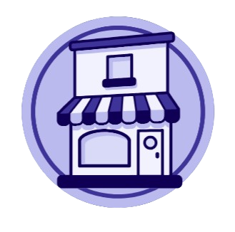

<p align="center">
  
</p>

<h1 align="center">Script Shop Management</h1>

<p align="center">
  <b>Pilotez toutes vos boutiques physiques depuis une seule application Odoo 19.</b><br>
  Achats, ventes en caisse, stock et chiffre d'affaires, boutique par boutique.
</p>

<p align="center">
  
  
  
</p>

---

## À quoi sert ce module ?

Quand une entreprise possède plusieurs boutiques, les informations sont dispersées dans Odoo : les ventes dans le Point de Vente, les achats dans Achats, les mouvements dans Inventaire. Il est difficile de répondre simplement à la question **« comment se porte ma boutique ? »**.

**Script Shop Management** rassemble ces informations dans une application unique. Chaque boutique est un point de vente Odoo, et le module relie à cette boutique les achats, les ventes, le stock et les produits qui la concernent. Le gérant voit en un coup d'œil l'activité de chaque boutique, ou de toutes les boutiques réunies.

## Ce que le module permet de faire

### 🏬 Déclarer ses boutiques
Dans la configuration d'un point de vente, une simple case **« Est une boutique »** le transforme en boutique, avec sa propre **image**. Les autres points de vente (stands, événements, ventes en ligne) restent en dehors du suivi.

### 📦 Savoir où chaque produit est vendu
Sur la fiche produit, le champ **« Disponible dans les boutiques »** indique dans quelles boutiques le produit est proposé. On sait immédiatement ce que chaque boutique a en rayon.

### 🛒 Rattacher les achats à une boutique
Chaque bon de commande fournisseur peut recevoir une **« Boutique de destination »**. On suit ainsi ce qui est acheté pour chaque boutique, et combien cela coûte.

### 🚚 Suivre les transferts de stock
Les transferts d'inventaire portent aussi une **« Boutique de destination »**. Les réapprovisionnements de chaque boutique sont visibles et traçables.

### 📊 Un tableau de bord par boutique
L'écran d'accueil affiche une carte **« Toutes les boutiques »** (avec le logo de la société) et une carte par boutique (avec son image). Un clic ouvre le tableau de bord de la boutique, avec un **sélecteur de période** et les indicateurs clés :

- montant des **achats** ;
- montant des **ventes** ;
- état du **stock** ;
- **chiffre d'affaires réel** ;
- **produits les plus vendus** et **les moins vendus**.

### 🔎 Des listes dédiées et une recherche rapide
Trois menus regroupent l'activité des boutiques, sans le bruit du reste d'Odoo :

| Menu | Contenu |
|---|---|
| **Achats** | Les achats ayant une boutique de destination |
| **Commandes** | Les commandes de caisse passées dans une boutique |
| **Stock** | Les transferts destinés à une boutique |

Dans chacun, la recherche se fait **par boutique** et **par produit**.

### 🔐 Des accès adaptés à chaque rôle
- **Utilisateur** : consulte l'activité des boutiques.
- **Responsable** : configure les boutiques et dispose de tous les droits.

Le module respecte le **multi-société** : chaque société ne voit que ses propres boutiques.

## Pour qui ?

- Les commerçants qui gèrent **plusieurs boutiques** avec Odoo Point de Vente.
- Les gérants qui veulent **comparer leurs boutiques** et repérer les produits qui marchent.
- Les intégrateurs Odoo qui cherchent une base simple et claire pour un réseau de magasins.

## Prérequis

- **Odoo 19.0** (Community ou Enterprise)
- Modules **Point de Vente**, **Achats** et **Inventaire** (installés automatiquement)

## Installation

1. Cloner le dépôt dans un dossier d'addons d'Odoo, **sous le nom `script_shop_management`** :
   ```bash
   git clone https://github.com/MaxTemat/Script_Shop_Management.git
   ```
2. Redémarrer Odoo, activer le mode développeur, puis **Applications → Mettre à jour la liste des applications**.
3. Rechercher **Script Shop Management** et cliquer sur **Activer**.

## Auteur

Développé par **Script Consulting**, consultant IT Odoo, dans le cadre de la série vidéo **« Boutique Locale »**.

## Boutiques en ligne (saison 2)

Le module s'étend aux sites web Odoo (dépendances `website_sale` et `website_sale_stock`). Un site web marqué « Est une boutique » devient une boutique en ligne, liée ou non à une boutique locale :

- **Est une boutique** : marque le site web comme boutique en ligne.
- **Boutique locale liée** : boutique locale dont le site reprend les données (facultatif).
- **Image de la boutique** : image du site quand il n'est pas lié.

Quand le site est lié, il reprend l'image, la boutique de destination et l'entrepôt de la boutique locale (champs en lecture seule). Une boutique locale ne peut être liée qu'à un seul site. Non lié, le site a son propre entrepôt, créé automatiquement.

**Stock partagé** : les commandes en ligne sortent de l'entrepôt du site (celui de la boutique locale si le site est lié), et la disponibilité affichée sur le site vient du stock de cet entrepôt. Un panier ouvert suit le changement d'entrepôt du site ; une commande confirmée garde son entrepôt.

**Visibilité des produits** : un site boutique n'affiche que ses produits (catalogue, recherche, accès direct par adresse). Un site lié affiche les produits dont la boutique de destination est sa boutique locale (champ « Disponible dans les boutiques »). Un site non lié affiche les produits assignés au site (champ « Disponible dans les boutiques en ligne »). Un produit sans boutique n'apparaît sur aucun site boutique ; les sites qui ne sont pas des boutiques ne changent pas.

Ces champs se trouvent dans **Site web › Configuration › Sites web**. **Commandes, sorties de stock et boutique de destination** : une commande passée sur un site boutique porte la boutique de ce site dans « Boutique de destination » (la boutique locale liée, ou « Boutique en ligne » pour un site non lié). Les sorties de stock, en caisse comme sur le site, portent la même boutique. Le menu **Commandes** réunit les commandes de caisse et les commandes des sites (colonne « Canal » : Local ou En ligne, hors paniers), et le menu **Stock** liste les transferts et les sorties de stock des boutiques.

**Menus et droits (groupes Utilisateur et Responsable)** : L'**Utilisateur** voit le tableau de bord, les achats, les commandes (caisse et site) et le stock, en lecture ; il reçoit pour cela les droits de lecture sur les commandes de vente. Le **Responsable** configure en plus les boutiques et les produits de chaque boutique ; les sites boutiques se configurent dans **Site web › Configuration › Sites web**. Sans groupe, les menus du module sont invisibles et le tableau de bord est refusé.

**Un stock, une boutique** : un entrepôt ne peut être le stock que d'une seule boutique. Le module refuse de cocher « Est une boutique » sur un point de vente dont l'entrepôt (type d'opération) est déjà celui d'une autre boutique ou d'un site boutique non lié, et de donner à un site non lié l'entrepôt d'une autre boutique. Le stock de chaque boutique est ainsi affiché une seule fois.

**Menu Stock** : deux sous-menus. **Tableau de bord** présente les articles en cartes (vue kanban : image, boutique, entrepôt, quantité, barre de disponibilité, réservé et disponible, état du stock en stock, stock faible ou rupture), regroupées par boutique (vue par défaut), et une vue liste ; les quantités s'additionnent sur toutes les boutiques, et se limitent à la boutique choisie quand on filtre sur une boutique. Les articles assignés à une boutique mais en rupture apparaissent avec 0. **Transferts** retrace tous les mouvements de stock des entrepôts des boutiques (réceptions, livraisons, sorties de caisse, ajustements d'inventaire), avec le sens (entrée, sortie, interne), la boutique et l'état ; un clic ouvre le transfert d'origine. Dans le tableau de bord d'une boutique, la carte **Stock** ouvre le tableau de bord du stock de cette boutique.

**Tableau de bord** : les boutiques en ligne apparaissent dans le tableau de bord. Une boutique locale liée à un site affiche un seul tableau de bord, avec les ventes en ligne comparées aux ventes locales (commandes, montant, chiffre d'affaires réel, part). Un site non lié a son propre tableau de bord : commandes, montant, chiffre d'affaires réel, stock de son entrepôt, achats reçus dans son entrepôt et produits les plus vendus. La carte « Toutes les boutiques » réunit l'ensemble.

## Licence

Distribué sous licence [LGPL-3](https://www.gnu.org/licenses/lgpl-3.0.html).
